<!-- ═══════════════════════════════════════════════════════════════
     ARLINDO COSSA JÚNIOR · GitHub Profile README
     Find & replace before publishing:
       YOUR_GH_USER   → your GitHub username (also the repo name)
       YOUR_LINKEDIN  → your LinkedIn handle (linkedin.com/in/<this>)
       YOUR_EMAIL     → public contact address
     ═══════════════════════════════════════════════════════════════ -->

<div align="center">


<a href="https://git.io/typing-svg"></a>

<br/>

<a href="https://www.linkedin.com/in/YOUR_LINKEDIN"></a>
<a href="mailto:YOUR_EMAIL"></a>


</div>

---

### `> whoami`

```yaml
name:        Arlindo Cossa Júnior   # aka Aizen
focus:       Cyber Risk & Strategy · Principal Cybersecurity · IT/OT/ICS Security
base:        Maputo, Mozambique
approach:    Translate technical exposure → business impact → executive decisions
domains:     [ cyber-risk, security-architecture, grc, it-ot-ics, cloud-identity, secops ]
methodology: ORBIT Security Model   # proprietary
heading:     Principal Cybersecurity Leadership → CISO-level responsibility
```

I'm a cybersecurity professional focused on aligning **security strategy, technical architecture and business risk** to build resilient organisations.

I treat cybersecurity as more than a technical discipline: an effective programme turns technical exposures into **business impact, measurable risk reduction and informed executive decisions**. My work pairs hands-on technical depth with strategic thinking — helping organisations see where they're exposed, prioritise what matters, and build security capabilities that serve business objectives.

I'm most drawn to the intersection of **cybersecurity strategy, enterprise risk, critical infrastructure and security architecture**.

---

### 🛰️ ORBIT — Proprietary Security Methodology

<div align="center">
  
</div>

**ORBIT** is my proprietary methodology for connecting **business context, cyber risk, operational impact and executive decision-making**. Its premise: security maturity should not be measured by the number of controls implemented or technologies deployed, but by whether security is covering what matters, operating well, and proven to work. Because the score is multiplicative, strength in one dimension can't hide a gap in another.

<div align="center">
  
</div>

<sub>ORBIT is an independent methodology under active development.</sub>

---

### 🎯 Professional Focus

<table>
<tr>
<td width="50%" valign="top">

**⚖️ Cyber Risk & Strategy**<br/>
<sub>Risk identification, assessment, prioritisation, treatment and executive-level risk communication.</sub>

**🏛️ Enterprise Security Architecture**<br/>
<sub>Security capabilities aligned with business requirements, organisational risk and operational reality.</sub>

**🏭 IT / OT / ICS Security**<br/>
<sub>Protecting industrial environments, critical infrastructure, operational technology and interconnected enterprise systems.</sub>

**📋 Governance, Risk & Compliance**<br/>
<sub>Security governance, ISMS development, policies, risk registers and control implementation.</sub>

</td>
<td width="50%" valign="top">

**☁️ Cloud & Identity Security**<br/>
<sub>Microsoft 365 security, Entra ID, Conditional Access, MFA, endpoint management and data protection.</sub>

**📡 Security Operations & Engineering**<br/>
<sub>Vulnerability management, monitoring, SIEM, incident response capability and control optimisation.</sub>

**📈 Security Program Development**<br/>
<sub>Measurable roadmaps, maturity models, operating processes and continuous improvement.</sub>

</td>
</tr>
</table>

---

### 🧭 Experience

Supporting and leading cybersecurity initiatives across **enterprise and industrial environments** — thousands of users and endpoints, industrial systems, and geographically distributed infrastructure — with a focus on turning security requirements into practical, measurable outcomes.

```diff
+ Cybersecurity programmes in large-scale, complex organisational environments
+ Security transformation across IT, OT, ICS and enterprise infrastructure
+ Controls and risk practices aligned with recognised industry frameworks
+ Vulnerability remediation, patch compliance, identity security and endpoint protection
+ Information security documentation, governance processes and control baselines
+ Security technology evaluation and gap analysis across infrastructure and SecOps
+ Technical findings connected to operational consequences and remediation decisions
```

---

### 📐 Frameworks & Standards

<div align="center">


</div>

> Not just implementing controls — understanding their purpose, measuring their effectiveness, and aligning them with the organisation's risk appetite and business context.

---

### ⚙️ Technology & Security Domains

<table>
<tr>
<th align="left">🔑 Identity & Access</th>
<th align="left">💻 Endpoint & Data</th>
<th align="left">📡 Security Operations</th>
<th align="left">🏭 Infrastructure & Industrial</th>
</tr>
<tr>
<td valign="top">

<br/>
<br/>
<br/>
<br/>


</td>
<td valign="top">

<br/>
<br/>
<br/>
<br/>


</td>
<td valign="top">

<br/>
<br/>
<br/>
<br/>
<br/>


</td>
<td valign="top">

<br/>
<br/>
<br/>
<br/>


</td>
</tr>
</table>

<div align="center">

</div>

---

### 🧪 Labs & Capability Development

<details>
<summary><b>🔭 Detection engineering — self-managed Elastic SIEM</b></summary>
<br/>

Multi-host Elastic Stack with segmented Fleet Servers and a dedicated collector tier — built and documented as an engineered system, not a dashboard.

</details>

<details>
<summary><b>🛡️ Endpoint hardening — tiered Windows baselines</b></summary>
<br/>

GPO-driven hardening standards for domain-joined Windows 10/11, mapped to maturity tiers so every control has a level and a validation path.

</details>

<details>
<summary><b>🧠 Security AI — local and private</b></summary>
<br/>

Running and fine-tuning open models on local hardware toward a security-specialised assistant — for environments where data can't leave the building.

</details>

<details>
<summary><b>🌍 Knowledge sharing — Mozambique & Africa</b></summary>
<br/>

Developing cybersecurity education, practical labs and knowledge-sharing that help professionals build technical competence and understand the strategic side of information security — contributing to a stronger cybersecurity ecosystem in Mozambique and across Africa.

</details>

---

### 🧠 Philosophy

```text
[01]  Security should be driven by risk, not by technology trends.
[02]  Every significant technical risk needs a clear business context.
[03]  Maturity requires measurable outcomes, ownership and accountability.
[04]  IT/OT convergence must balance security, safety, availability and continuity.
[05]  Frameworks matter when they improve decisions — not when they generate paper.
[06]  The strongest leaders understand how systems fail AND how businesses operate.
```

---

### 📡 Telemetry

<div align="center">


<br/>

<picture>
  <source media="(prefers-color-scheme: dark)"  srcset="https://raw.githubusercontent.com/YOUR_GH_USER/YOUR_GH_USER/output/snake-dark.svg"/>
  <source media="(prefers-color-scheme: light)" srcset="https://raw.githubusercontent.com/YOUR_GH_USER/YOUR_GH_USER/output/snake-light.svg"/>
  
</picture>

</div>

---

### 🤝 Connect

Open to collaboration on **cybersecurity strategy, enterprise security architecture, IT/OT security, GRC, risk management**, and initiatives that strengthen cybersecurity capability across Africa.

<div align="center">

<br/>

**Security is not just about defending systems.<br/>It is about protecting the business decisions, operations and trust that depend on them.**

<br/>


<sub><i>Arlindo Cossa Júnior · Cybersecurity · Risk · Strategy</i></sub>

</div>
